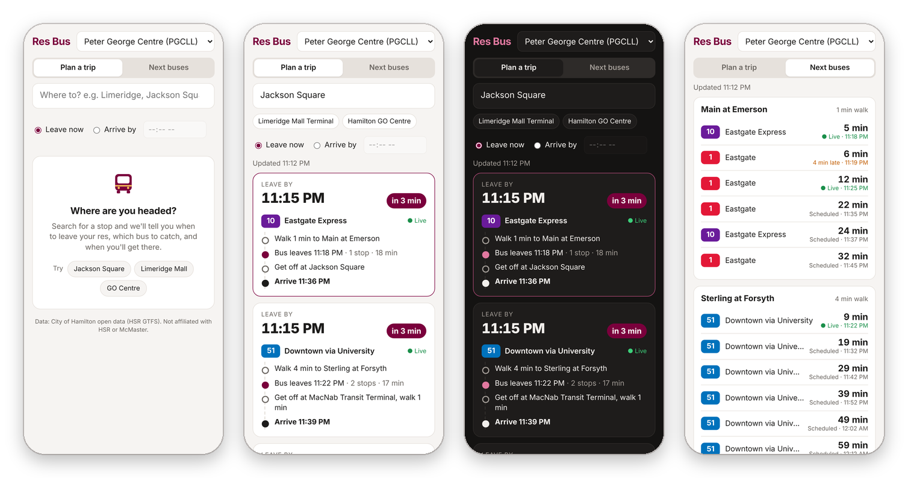
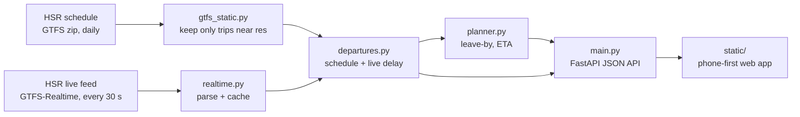

<div align="center">


# Res Bus

**Tells McMaster students exactly when to leave res to catch the bus.**

Pick your residence and where you're going. Res Bus shows which stop to walk to, which bus to take,<br>
when you'll arrive, and a **"leave by"** countdown, all adjusted with live data from Hamilton Street Railway (HSR).

[](https://github.com/bunip91274/hsr-bus-tracker/actions/workflows/tests.yml)


[](LICENSE)



<sub>Screenshots use a demo feed.</sub>

</div>

---

## Why

The existing transit apps make you hunt for a stop on a map every time. When you live in residence, the question is always the same: *"When do I need to leave to make it?"* Res Bus answers it in one screen.

## Features

- 🧭 **Trip planner**: shows when to leave, which stop to walk to, which bus to take, how many stops to ride, and when you'll arrive
- ⏱️ **Arrive-by mode**: "class at 9:00" lists the latest bus you can get away with
- 🔴 **Live predictions**: delays shift every time on screen; cancelled trips and skipped stops are never suggested
- 🚏 **Next buses board**: live departures at every stop within walking distance of your res
- 🌗 **Light and dark mode**, and **installable** on your phone's home screen (PWA)
- 🛟 **Keeps working when the live feed drops**: falls back to the timetable and says so

## How it works



### The interesting parts

| Problem | How it's handled |
|---|---|
| **A 70 MB timetable** | `stop_times.txt` is streamed **twice**: first to find trips that pass near a residence, then to keep only those trips. Most of the city never enters memory. |
| **Buses after midnight** | GTFS writes a 1 AM bus on Friday's schedule as `25:00:00`. Times are stored as seconds into the service day, and yesterday's, today's and tomorrow's schedules are all checked. |
| **Daylight saving time** | Service-day times are measured from *noon minus 12 h*, not midnight, so the 25-hour day in November doesn't shift every bus by an hour. |
| **Holidays** | `calendar_dates.txt` exceptions are applied, e.g. Thanksgiving running a Saturday schedule. |
| **Merging live data** | Each stop's prediction uses the best data available: an exact predicted time, then a delay carried over from the bus's last reported stop, then a trip-wide delay, then the timetable. |
| **Pointless options** | Any option that makes you leave earlier *and* arrive later than another is dropped. |
| **Nearby stops** | Destinations include stops within 250 m, so the planner will tell you to get off at MacNab Terminal and walk a minute if that bus is faster. |

## Run it

Requires **Python 3.11+**.

```bash
git clone https://github.com/bunip91274/hsr-bus-tracker.git
cd hsr-bus-tracker
python -m venv .venv
source .venv/bin/activate          # Windows: .venv\Scripts\activate
pip install -r requirements.txt
uvicorn app.main:app --reload
```

Then open **http://localhost:8000**. The first start downloads HSR's schedule (about 13 MB) and caches it for 24 hours.

<details>
<summary><b>Try it on your phone</b></summary>

<br>

- **Quick test:** run `cloudflared tunnel --url http://localhost:8000` and open the `https://….trycloudflare.com` link on your phone. This works on campus Wi-Fi, which usually blocks phone-to-laptop connections.
- **Always on:** on [Render](https://render.com), choose *New → Blueprint* and pick this repo. `render.yaml` is already set up.
- **Install it:** open the site in Chrome (**⋮ → Add to Home screen**) or Safari (**Share → Add to Home Screen**).

</details>

<details>
<summary><b>Configuration</b></summary>

<br>

Every setting in [`app/config.py`](app/config.py) can be overridden with an environment variable:

| Variable | Default | What it does |
|---|---|---|
| `HSR_NEARBY_RADIUS_M` | `500` | How far you'll walk from res to a stop |
| `HSR_WINDOW_MINUTES` | `90` | How far ahead the board looks |
| `HSR_REALTIME_TTL` | `30` | Seconds between live-feed fetches |
| `HSR_STATIC_URL` | City of Hamilton feed | Schedule zip (a local path works too) |

Residence locations live in [`app/data/residences.json`](app/data/residences.json).

</details>

## Tests

```bash
pip install -r requirements-dev.txt
pytest          # 22 tests, run offline
ruff check .    # lint
```

The tests use a small hand-built GTFS feed and fake live-feed messages ([`tests/fixtures.py`](tests/fixtures.py)). They cover holidays, after-midnight trips, DST, delays carried over from earlier stops, cancellations, and the planner's option filtering. CI runs everything on every push.

## Project structure

```
app/
├── config.py        settings and environment overrides
├── gtfs_static.py   schedule loader (two-pass streaming)
├── realtime.py      GTFS-Realtime parser + cache
├── departures.py    next buses at a stop
├── planner.py       trip planner
├── residences.py    residences and nearby stops
├── geo.py           haversine distance
└── main.py          FastAPI app and API routes
static/              web app (vanilla JS, no build step)
tests/               pytest suite + fixture feeds
```

## Roadmap

- [x] Live departures board
- [x] Trip planner with leave-by time and arrive-by mode
- [x] Installable PWA with light and dark mode
- [ ] Verify residence coordinates (currently approximate)
- [ ] Search by address or place, not just stop name
- [ ] Transfers (RAPTOR routing)
- [ ] Service alerts (detours, stop closures)
- [ ] Deploy publicly

## Credits

Schedule and live data come from [City of Hamilton Open Data](https://www.hamilton.ca/city-council/data-maps/open-data), used under its open data licence. This project is not affiliated with HSR, the City of Hamilton, or McMaster University.

The initial version was built with AI pair-programming (Claude).

Released under the [MIT License](LICENSE).
